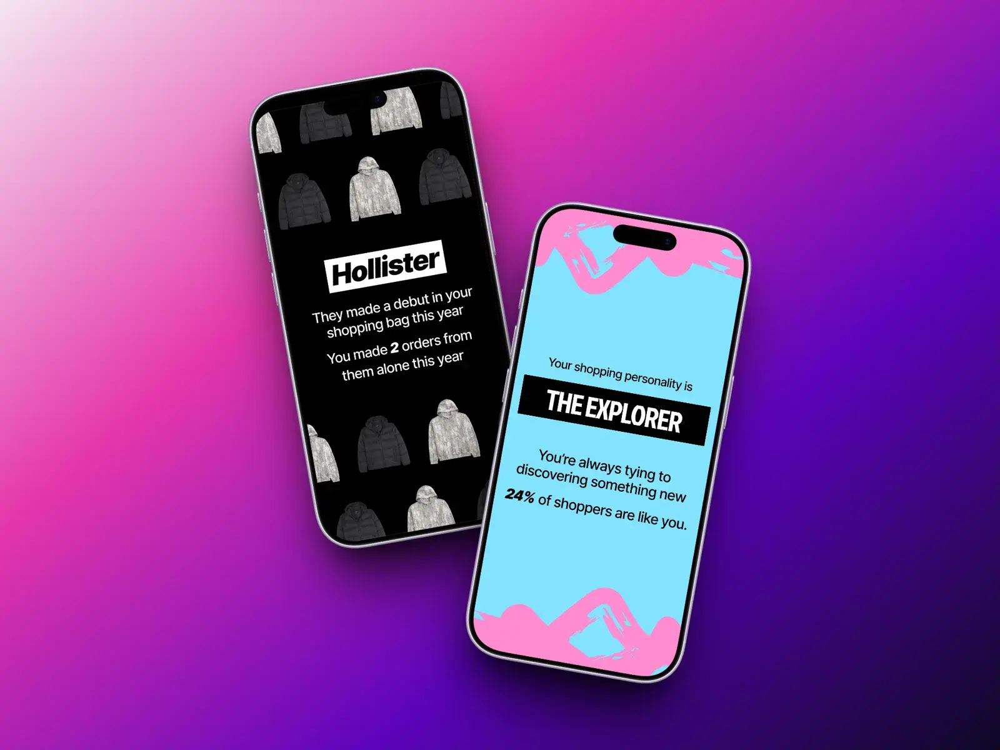

# Shop Wrapped

A Spotify Wrapped style year in review for your Shopify purchases. It runs as a Shop Mini inside the Shop app.



## What it shows

- How much you spent and saved
- How many orders you placed
- Your favorite shop and top products
- Your shopping personality
- Your year in numbers

Swipe through the cards like Instagram stories, then export them as images to share.

## Tech

React, TypeScript, Tailwind CSS v4, Vite, and the Shop Minis SDK (`@shopify/shop-minis-react`).

## Structure

```
swp/src/
├── components/ShopifyWrapped.tsx   # slide navigation
├── components/story-cards/         # one component per card
├── hooks/useShopifyWrappedData.ts  # fetches orders, saved products, shops
└── utils/shoppingAnalytics.ts      # turns raw data into stats
```
